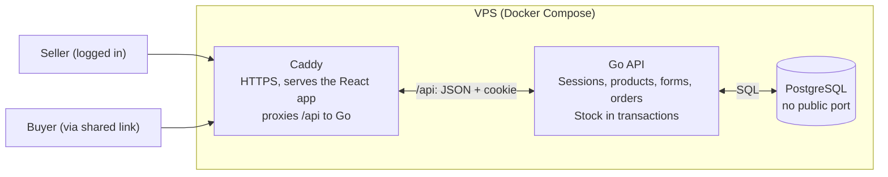
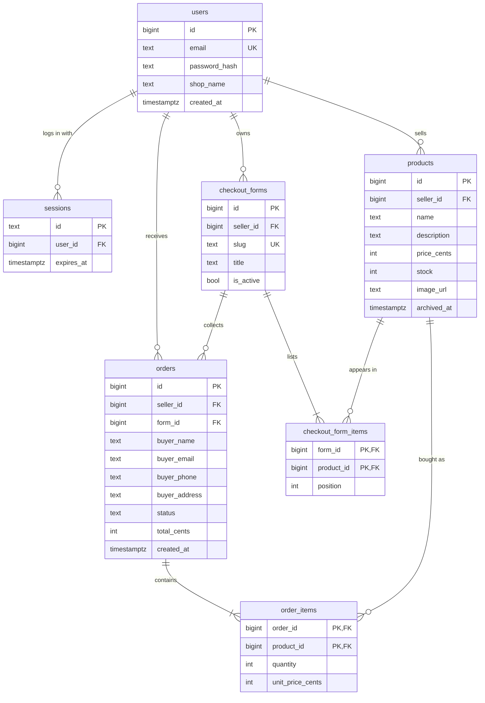
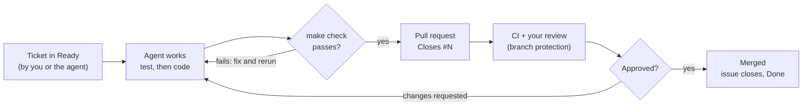

# ShopLink — Design Document

Nov 18, 2026

## Intent and why

ShopLink is a full-stack portfolio project built to get recruiters to contact you. A seller adds products, creates a checkout form, and shares its link; a buyer opens the link and places an order without an account.

You have frontend projects but none you built end to end. ShopLink fills that gap with three kinds of proof in one repo: frontend work in React, a backend you wrote in Go, and a development process run with AI coding agents working from tickets in a test-driven feedback loop.

Success means a recruiter can open a live demo and a public repo in under a minute and see all three. It also means you can explain every part of the code when a recruiter hands you to an interviewer.

## Goals, non-goals, anti-goals

**Goals**

- A live demo where a seller signs up, adds products, creates a checkout link, receives an order, and updates its status.
- A Go backend you can explain line by line: login sessions, sellers only seeing their own data, input validation, and stock that never goes below zero when two buyers order at once.
- A public repo that shows the agentic workflow: a `CLAUDE.md`, written specs, tickets, agent-written pull requests, your review comments, and green CI runs.

**Non-goals for now**

- Real payments. Test-mode payments are an optional final phase.
- Shipping and tax calculation, multiple currencies, discount codes, email notifications, team accounts, and a mobile app.

**Anti-goals: failure even if the app works**

- Code you can't explain in an interview.
- A large app left half finished. A small app that is complete beats a big one that isn't.
- Hiding or overstating how AI was used. The README says plainly that agents wrote code and you reviewed it.
- Handling real card numbers or real customer data.

## Approaches

You picked a separate React frontend talking to a Go API, because it shows both skills clearly and matches how most companies build web apps.

| Approach | What it is | Trade-off | Decision |
| --- | --- | --- | --- |
| Separate frontend + Go API | React app calls a JSON API written in Go | Shows both skills and gives the most interview material; two pieces to deploy | Picked |
| Go serves everything | Go renders pages with its built-in templates | One thing to deploy, but hides your frontend strength | Rejected |
| Static site + Go serverless functions | Static pages plus a few small functions | Cheap to host, but the backend is too thin to prove much | Rejected |

We also chose a standalone app over turning the portfolio site itself into the backend project, because one real product tells a recruiter more. Among the app ideas, you chose your own: shareable checkout forms.

## Product

ShopLink has two sides: a private seller dashboard and a public checkout page that anyone with the link can open.

**Seller side (login required)**

- Sign up, log in, log out.
- Products: add, edit, archive. Each has a name, description, price, stock count, and one image.
- Checkout forms: pick one or more products, give the form a title, and get a short public link like `shoplink.app/c/x7k2`. A form can be switched off without deleting it.
- Orders: a list of incoming orders with buyer details and items, filterable by status. The seller moves each order along manually.

**Buyer side (no account)**

- Open the link, see the products and prices, choose quantities, and enter name, email, phone, and address.
- Place the order and see a confirmation page with an order number.

**Order statuses:** New → Paid → Shipped → Completed, with Cancelled possible from New or Paid. Because the first version has no payment step, the seller marks an order Paid after receiving a bank transfer or cash.

**Business rules**

- A seller can only see and change their own products, forms, and orders.
- Placing an order checks and reduces stock in one database transaction, so two buyers can't buy the last item at the same time. Cancelling an order returns its stock.
- Prices are stored as whole numbers of the smallest unit (cents), never as decimals, and each order saves the price at the time of purchase.
- A switched-off form, or one whose products are all out of stock, shows a clear message instead of the order form.

## Architecture

A React single-page app talks to a Go JSON API, which stores everything in PostgreSQL; the two halves live in one repo and run as Docker containers on one VPS, behind Caddy on a single domain.

The React app (seller dashboard and public checkout) is built into static files that Caddy serves. Because the app and the API share one domain, the login cookie is same-site and production needs no CORS. Locally, the same pieces run with Docker Compose and the Vite dev server.

Sellers and buyers both use the React app, which reaches data only through the Go API. That makes the API the single place where login, ownership, and stock rules are enforced.

**Stack**

| Part | Choice | Why |
| --- | --- | --- |
| Frontend | React + Vite + TypeScript, React Router | The most-requested frontend stack in job ads; TypeScript lets the agent catch its own mistakes |
| Backend | Go 1.22+ standard library `net/http` (built-in route patterns), `pgx` database driver | No framework magic, so every line is yours to explain |
| Database | PostgreSQL, run locally with Docker Compose | Real transactions and row locking for the stock rule; the same Docker setup runs locally and on the server |
| Migrations | Plain SQL files with a migration tool (goose or golang-migrate) | Schema changes are reviewable in pull requests |
| Login | Server-side sessions in an HttpOnly, Secure, SameSite cookie; bcrypt password hashing | Simpler and safer than JWTs for a browser app, and easy to explain |
| Hosting | One VPS (2 vCPU, 2 GB RAM, 40 GB disk) running Docker Compose: Caddy, the Go API, and Postgres. Images are built in GitHub Actions, pushed to ghcr.io, and pulled by the server | No cold starts for recruiters, a fixed monthly cost, and same-site cookies; in exchange you handle server upkeep and backups |

**Data model**

Schema rules: `stock` has a `CHECK (stock >= 0)` constraint as a second safety net behind the transaction. Products are archived (`archived_at`), never deleted, because old orders point to them. `order_items.unit_price_cents` keeps the price paid even if the product price changes later.

**API endpoints**

| Method + path | Access | Purpose |
| --- | --- | --- |
| `POST /api/auth/signup`, `/login`, `/logout` | Public | Create account, start or end a session |
| `GET /api/me` | Seller | Current seller's profile |
| `GET`, `POST /api/products` | Seller | List or add products |
| `GET`, `PATCH`, `DELETE /api/products/{id}` | Seller | Read, edit, or archive one product |
| `GET`, `POST /api/forms` | Seller | List or create checkout forms |
| `GET`, `PATCH`, `DELETE /api/forms/{id}` | Seller | Read, edit, switch off, or remove one form |
| `GET /api/orders` | Seller | List orders, filter by status |
| `GET`, `PATCH /api/orders/{id}` | Seller | Read one order or change its status |
| `GET /api/c/{slug}` | Public | Checkout form with its products |
| `POST /api/c/{slug}/orders` | Public | Place an order |

Every seller route checks that the record belongs to the logged-in seller and returns 404 otherwise, so other sellers' IDs can't be probed. Errors use one JSON shape, `{"error": {"code", "message"}}`, which the frontend shows to the user. The public order route is rate-limited per IP address to slow down spam.

## Database access

The agent reaches the database through the terminal, using the same local Postgres you see in DBeaver; it never has a path to production.

**The agent sets up the database.** In Phase 0 it writes the Docker Compose service, the init script that creates both database users, the first migration, and a seed script with a demo seller and sample products. Then it runs them and confirms the result with `make check`. Because the whole setup is code, `make db-reset` rebuilds the local database from scratch in seconds, so the agent can start clean whenever it needs to. The one thing it doesn't do is touch the server: you set up the VPS and write its production `.env` yourself.

- **Two database users,** created by an init script in Docker Compose: `shoplink` owns the schema and is used by the app and migrations. `shoplink_readonly` can only read, and is what the agent uses to inspect data.
- **Agent inspects with `make db-shell`,** which wraps `docker compose exec db psql -U shoplink_readonly shoplink`. It can run any `SELECT` but can't change data.
- **Schema changes only through migration files:** `make migration name=<name>` creates one, `make migrate` applies it, and the file is reviewed in the pull request like any code.
- **Production stays out of reach:** the production database runs in a container on the VPS with no port open to the internet, and its password lives only in the server's `.env`. That password and the server's SSH deploy key never appear in the repo, the local `.env`, `CLAUDE.md`, or tickets, and the agent never gets a shell on the server.
- **Nightly backups:** a scheduled `pg_dump` copies the production database to storage outside the server and keeps the last 14 dumps. Restore steps live in `docs/deploy.md` and are tested once.
- **CI and the GitHub Action** start an empty Postgres for each run, apply migrations, run the tests, and throw it away.
- **You use DBeaver** on `localhost:5432` with the credentials from `.env` (copied from the committed `.env.example`). Log in as `shoplink` when you want to edit test data by hand.

You chose terminal access over a Postgres MCP server because it needs no extra setup. An MCP server can be added later if exploring data through the terminal gets clumsy.

## Development workflow

AI coding agents (Claude Code) write most of the code in small, test-first steps; one command checks every change; you review and merge everything.

**One command checks everything: `make check`**

- Go: `gofmt` check, `go vet`, `golangci-lint`, and `go test ./...` including tests that run against a real Postgres in Docker.
- Frontend: TypeScript type-check, ESLint, and Vitest unit tests.
- End to end: Playwright tests for the three key flows (seller creates a product and form; buyer places an order; seller marks it shipped). These run as `make e2e`, because they are slower, and in CI on every pull request.

**The loop for every task**

1. The agent reads the ticket, the relevant part of this design, and `CLAUDE.md`.
2. It writes a failing test that captures the ticket's acceptance criteria.
3. It writes the code, runs `make check`, reads the failures, and fixes them until everything passes.
4. It commits on a branch named after the ticket and opens a pull request.
5. You read the diff, ask the agent to explain anything unclear, and request changes or merge.

**Improving the loop, not just the code**

- When the agent makes the same mistake twice, add a rule to `CLAUDE.md` or a test that catches it.
- When a bug reaches the demo, first write the test that would have caught it.
- Keep a short `docs/agent-notes.md` log of what worked and what didn't. It makes a strong interview story.

**Continuous integration:** a GitHub Actions workflow runs `make check` and the end-to-end tests on every push and pull request. Merges to `main` build the Docker images, push them to ghcr.io, and deploy to the VPS over SSH; the deploy fails if `/healthz` doesn't answer afterwards.

## Ticket workflow

Every piece of work is a GitHub issue on a GitHub Projects board, and both you and the agent create and move tickets.

A failing check sends work back to the agent before you ever see it, and your review is the last gate before `main`.

**Board columns:** Backlog → Ready → In progress → In review → Done. Labels: `area:backend`, `area:frontend`, `area:infra`, `type:feature`, `type:bug`. One milestone per phase.

**Issue template (every ticket has these sections)**

- Goal: one or two sentences on what the user can do afterward.
- Acceptance criteria: a checklist, each item testable.
- Out of scope: what this ticket must not touch.
- Notes: relevant files, endpoints, or design sections.

**Direction 1: the agent creates and updates tickets.** At the start of each phase, Claude Code turns that phase of this design into issues, each small enough for one pull request. While it works locally, it uses the `gh` command-line tool to comment when it starts, move the card, and open a pull request containing "Closes #N", which closes the issue when merged.

**Direction 2: you write a ticket and the agent does it.** The Claude Code GitHub Action ([anthropics/claude-code-action](https://github.com/anthropics/claude-code-action)) runs on GitHub when you mention `@claude` in an issue or assign the issue to Claude. It implements the change on a branch, opens a pull request, and keeps a progress checklist updated in its comment. Set it up by running `/install-github-app` inside Claude Code.

**Guardrails**

- Branch protection on `main`: every change goes through a pull request, and CI must pass once it exists. Required approvals are set to 0, because GitHub won't let you approve pull requests opened from your own account, which is the account the agent uses. You review every diff, and your merge is the sign-off. The agent never merges.
- Secrets (database password, SSH deploy key, API key) live in GitHub secrets and the server's `.env`, never in the repo or in tickets.
- The GitHub Action uses an API key billed per use. Set a monthly spending limit before turning it on.
- Tickets stay small: one feature slice each, such as "seller can create a product (API + form + tests)".

## Phases

Five phases, each ending with something deployed and showable; phase 4 is optional.

1. **Phase 0: Foundation.** Repo, `CLAUDE.md`, issue template, board, local database set up by the agent (Docker Compose, two database users, first migration, seed data), empty Go server with a `/healthz` route, empty React app, `make check`, CI, the VPS set up, and the app deployed to it with nightly backups.
   - Done when: CI is green and the live site shows "API OK" from the backend over HTTPS.
2. **Phase 1: Seller accounts and products.** Sign up, log in, log out, and product add/edit/archive with image URL.
   - Done when: a seller can manage products on the live site, and tests prove one seller can't read another's products.
3. **Phase 2: Checkout forms and ordering.** Create and switch off forms, the public checkout page, placing orders, stock handling.
   - Done when: a buyer orders through a shared link, and a test proves two simultaneous orders for the last item can't both succeed.
4. **Phase 3: Orders dashboard and polish.** Order list, filters, status changes, cancel-returns-stock, empty and error states, mobile layout, a demo seller account with sample data, and the README with screenshots and a "How this was built" section.
   - Done when: a recruiter can try the whole flow from the README in under five minutes.
5. **Phase 4 (optional): Test-mode payments.** A payment provider's test mode, webhooks that mark orders Paid, and handling for failed payments.
   - Done when: a buyer pays with a test card and the order turns Paid without the seller touching it.

## Decisions, open items, and builder's choices

You decided the app, its name, the frontend-plus-Go-API split, the agentic, ticket-driven workflow, and hosting on a single VPS; the rest below are my calls, which you can overturn.

**Hosting on a VPS (decided Nov 18, 2026):** you chose one VPS over Render and Vercel. It avoids free-tier servers that sleep and make a recruiter's first click wait, keeps the cost fixed, and puts the app and API on one domain. The price is server upkeep, HTTPS, and backups, which are covered in Phase 0.

**Calls made for you**

- React + Vite + TypeScript for the frontend. You haven't confirmed your frontend tools yet.
- Orders first, payments last.
- PostgreSQL instead of SQLite. It is the usual production choice, and it makes the stock rule a good interview topic.
- Cookie sessions instead of JWTs, Go's standard library instead of a framework, GitHub Issues instead of Jira or Linear, and Caddy for HTTPS on the VPS.
- Agents write most of the code and you review every line.

**Open items**

- Confirm the frontend stack.
- Name check: search that "ShopLink" isn't confusing next to existing products, and say "portfolio project" in the README.

**Left to the builder:** folder layout, styling approach, component structure, choice between the two migration tools, test helpers, and exact wording of error messages.

## Agent instructions

The agent's working rules live in `CLAUDE.md` at the repo root.
